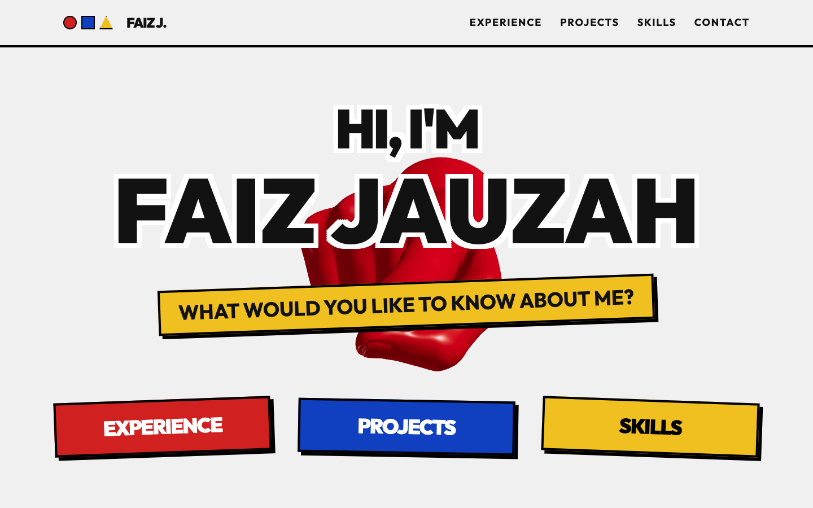

# Faiz Jauzah — Portfolio

A single-page, Bauhaus-inspired portfolio for **Faiz Jauzah**: web, mobile, and machine-learning work presented with a cursor-reactive 3D hand, heavy black borders, hard offset shadows, and primary colours.

**[Live site](https://faizjauzah.github.io/portfolio/)** · [](https://github.com/faizjauzah/portfolio/actions/workflows/deploy.yml)



## About this project

I'm Faiz. I build things across web, mobile, and machine learning — from semi-supervised computer-vision pipelines to full-stack apps. This repository is both my portfolio and its source: one page, no CMS, and no router.

**Currently:** open to internship or full-time roles in AI/ML engineering, data science, computer vision, web or mobile development, and software engineering.

## What's inside

- **Cursor-reactive 3D hero.** `public/hand.obj` is loaded with three.js, given a Bauhaus-red material, scaled and centred automatically, then rotated toward the pointer with `useFrame`.
- **Experience accordion.** Three roles, one panel open at a time, built from the reusable `Accordion` primitive.
- **Project grid.** Work with a type eyebrow, description, tags, and live-demo or GitHub links where they exist.
- **Skills wall.** Four categories rendered as geometric chips — squares and pills in alternating colours.
- **Contact block.** Availability message, email, and social links, with smooth in-page scrolling that accounts for the sticky navbar.

## Tech stack

React 19 · TypeScript (strict) · Vite 8 · Tailwind CSS v4 · react-three-fiber / three.js · lucide-react · clsx + tailwind-merge

## Getting started

Requires Node 20+ and npm.

```bash
npm install
npm run dev
```

Open **http://localhost:5173/portfolio/**. The root URL redirects, so use the base path.

| Script            | What it does                                                        |
| ----------------- | ------------------------------------------------------------------- |
| `npm run dev`     | Vite dev server with HMR at `/portfolio/`                           |
| `npm run build`   | `tsc -b && vite build` — this is also the typecheck                 |
| `npm run lint`    | ESLint over `**/*.{ts,tsx}`                                          |
| `npm run preview` | Serve the production build locally                                   |

`npm run build` uses strict TypeScript with `noUnusedLocals`. The build prints a warning about a chunk over 500 kB; that comes from three.js and is expected.

There is no test runner or formatter configured.

## Project structure

```text
public/
  hand.obj              # 3D model loaded by the hero
  j-logo.svg            # favicon / brand mark
src/
  main.tsx              # entry point
  App.tsx               # stacks the six sections; no router
  index.css             # Tailwind import, theme tokens, Bauhaus utilities
  components/
    sections/           # Navbar, Hero, Experience, Projects, Skills, Footer
    3d/                 # Hero canvas and HandModel loader
    ui/                 # Card, Accordion, Button primitives
  lib/                  # cn() class merger, scrollToSection()
docs/
  preview.png           # README screenshot
.github/workflows/
  deploy.yml            # build and publish to GitHub Pages
```

Page copy and data are hardcoded inside each section component — there is no content layer or CMS.

## Where to edit content

| What                                              | File                                         |
| ------------------------------------------------- | -------------------------------------------- |
| Hero heading, intro line, and the three nav cards | `src/components/sections/HeroSection.tsx`    |
| Experience entries                                | `src/components/sections/ExperienceSection.tsx` |
| Projects (copy, tags, demo and repo links)        | `src/components/sections/ProjectsSection.tsx` |
| Skills categories                                 | `src/components/sections/SkillsSection.tsx`  |
| Navbar links and logo                             | `src/components/sections/Navbar.tsx`         |
| Contact links and availability copy               | `src/components/sections/Footer.tsx`         |
| Page title and favicon                            | `index.html`                                 |
| Colours, type, shadows, and decorative utilities  | `src/index.css`                              |

In-page links target the section ids `experience`, `projects`, `skills`, and `contact`. Keep those ids and the navbar list in sync.

## Design system

The site is **Bauhaus-inspired** rather than a reproduction of the historical school. It borrows the visual language and applies it consistently:

| Token        | Value     | Used for                          |
| ------------ | --------- | --------------------------------- |
| Background   | `#F0F0F0` | Page and navbar                   |
| Foreground   | `#121212` | Type, borders, and hard shadows   |
| Red          | `#D02020` | Primary actions and accents       |
| Blue         | `#1040C0` | Section backgrounds and accents   |
| Yellow       | `#F0C020` | Highlights and availability block |

- **Type:** Outfit (400/500/700/900), uppercase for display copy with tight tracking.
- **Shape:** square corners by default; pills are explicit exceptions.
- **Depth:** heavy black borders (usually 4px, 2px on small chips) and hard offset shadows (`bauhaus-shadow-*` or `shadow-[Npx_Npx_0_0_black]`), never soft blurs.
- **Motifs:** circles, squares, and triangles, with small rotations and opaque geometric decoration.

Tokens are declared in `src/index.css` under `@theme`, but components consistently use inline arbitrary hex utilities such as `bg-[#D02020]`. Follow that convention. Tailwind v4 has no `tailwind.config.js`; add new theme values and custom utilities in `src/index.css`.

## Deployment

Pushing to `main` runs `.github/workflows/deploy.yml`, which installs with `npm ci` on Node 20, builds, and publishes `dist/` to GitHub Pages.

`base: "/portfolio/"` in `vite.config.ts` must match the repository name. Public assets are referenced through `import.meta.env.BASE_URL` (see `HandModel.tsx`), never as root-absolute paths.

## Contact

- Email: [mfaizjauzah24@gmail.com](mailto:mfaizjauzah24@gmail.com)
- LinkedIn: [linkedin.com/in/faizjauzah](https://www.linkedin.com/in/faizjauzah)
- GitHub: [github.com/faizjauzah](https://github.com/faizjauzah)
- Instagram: [@faizjauzah](https://instagram.com/faizjauzah)

## Notes

This is a personal project. The source is public so you can see how it is built, but the written content, identity, and project descriptions are mine — please don't reuse them as your own. No open-source license is granted.

If you're working in this repo with an AI agent, [`AGENTS.md`](AGENTS.md) documents the commands, base-path rules, and styling conventions. Humans are welcome to read it too.
